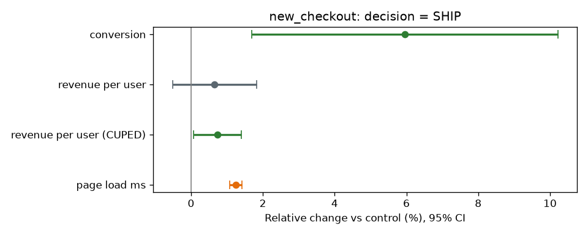

# Experimentation Platform

[](https://github.com/Saigwe/experimentation-platform/actions/workflows/ci.yml)
 

> **Headline:** the new checkout lifts conversion **+6.0% (95% CI +1.7% to +10.2%)**, worth about **$670k a year**. Ship it. A second test was **blocked automatically** because its data was broken.

A/B test analysis the way product and analytics teams run it in production: check that the experiment is valid, measure the primary metric with honest uncertainty, cut noise with CUPED, check guardrails, then make one clear call: **ship, don't ship, or keep running**.



## What it does

| Step | Why it matters |
|---|---|
| **Sample ratio mismatch (SRM) check:** chi-square test on the arm sizes | If a logging or assignment bug drops users from one arm, every downstream number is biased. The `free_shipping_banner` test fails this check (p = 7e-5) and the readout refuses to report a result. |
| **Primary metric:** conversion, as a two-proportion z-test with a confidence interval on relative lift | Leaders get a range, not just a point estimate |
| **CUPED:** adjusts revenue for each user's pre-experiment spend | Cuts revenue variance by **68%**, equivalent to running with much more traffic, without biasing the estimate |
| **Guardrail:** page load time, with a 2% maximum allowed regression | A win on revenue can't ship if it slows the site beyond the limit |
| **Decision rule:** ship only if the primary metric is significant, revenue is positive and guardrails hold | Turns statistics into a call a VP can act on |
| **Power and sample size** for the next test | "To detect a 3% lift we need 161k users per arm," set before launch, not after |

The readout for leadership is [`output/readout.md`](output/readout.md).

## Validation

Both experiments are simulated with **known ground truth**, so the method can be checked:
- **`new_checkout`:** a planted +4% conversion lift. The estimated confidence interval contains it.
- **`free_shipping_banner`:** a planted logging bug that drops low-engagement treatment users. The SRM check catches it.

Tests also cover the statistics directly. CUPED keeps the mean and cuts variance on a known relationship, the sample-size formula matches the textbook value, and the proportion test detects a known difference.

## Run it

```bash
pip install -r requirements.txt
python -m experiments.analyze     # writes output/readout.md and charts
pytest
```

## Stack

Python, NumPy, pandas, SciPy, matplotlib, pytest.
