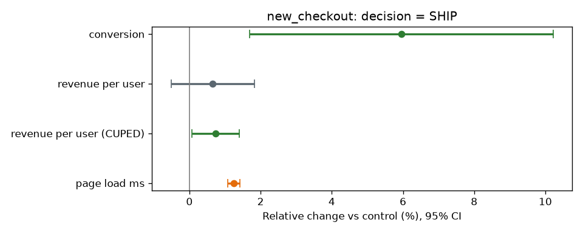

# Experiment readout

## new_checkout: SHIP

- **Conversion:** 9.79% → 10.37%, +6.0% (95% CI +1.7% to +10.2%, p=0.006)
- **Revenue per user (CUPED-adjusted):** +0.7% (95% CI +0.1% to +1.4%, p=0.031), about **$673,685 a year** at 2M checkout users
- **Guardrail, page load:** +1.2% (95% CI +1.1% to +1.4%, p=0.000); limit is +2%, so within limit
- **Sample:** 39,896 vs 40,104 users, split check passed (p = 0.46)
- **Method note:** adjusting for pre-experiment spend (CUPED) cut revenue variance by **68%**,
  the equivalent of running the test with that much more traffic.

## free_shipping_banner: INVALID: do not read results

The split is **30,058 control vs 29,092 treatment** against a planned 50/50
(sample ratio mismatch, p = 7.1e-05). Users are missing from one arm, most likely a logging or
assignment bug, so any lift measured here is biased. **Action:** fix tracking, then rerun. No result is reported.

## Planning the next test

To detect a 3% relative lift on a 9.9% conversion rate (80% power, 5% significance) we need **161,254 users per arm**.
